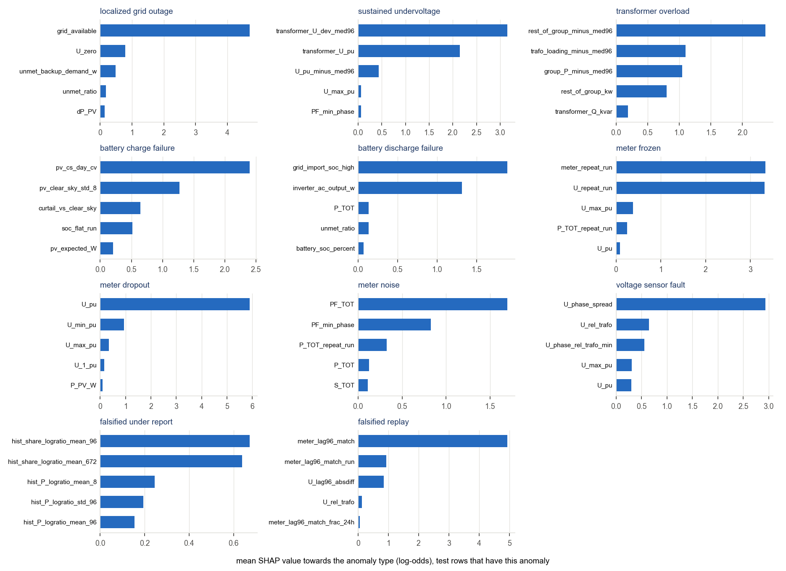

# Explainability of the single-house xgboost model (SHAP and LIME)

## 1. Are the SHAP values right?

- The SHAP contributions plus the bias add up to the model output: max probability difference 4.2e-07 on 300 test rows.
- Native TreeSHAP vs the `shap` package (TreeExplainer): max difference 0.0e+00 on 100 rows.

## 2. What drives each anomaly type (global SHAP)

Mean SHAP value of each feature towards the anomaly type, on the test rows that truly have it. Top 3 per type (full list: `xai_shap_top_features.csv`).

| Anomaly type | Top features (meaning) |
|---|---|
| localized_grid_outage | `grid_available` (grid (STEG) available); `U_zero` (no voltage at the meter); `unmet_backup_demand_w` (backup demand not served) |
| sustained_undervoltage | `transformer_U_dev_med96` (transformer low-voltage side voltage); `transformer_U_pu` (transformer low-voltage side voltage); `U_pu_minus_med96` (house voltage vs its recent level) |
| transformer_overload | `rest_of_group_minus_med96` (power of the rest of the monitored group); `trafo_loading_minus_med96` (transformer loading vs its recent level); `group_P_minus_med96` (power of the monitored group under the transformer) |
| battery_charge_failure | `pv_cs_day_cv` (solar production vs clear-sky level); `pv_clear_sky_std_8` (solar production vs clear-sky level); `curtail_vs_clear_sky` (solar power not used) |
| battery_discharge_failure | `grid_import_soc_high` (importing from the grid although the battery is charged); `inverter_ac_output_w` (inverter output / status); `P_TOT` (meter active power) |
| meter_frozen | `meter_repeat_run` (meter values repeated exactly); `U_repeat_run` (voltage value repeated exactly); `U_max_pu` (house voltage) |
| meter_dropout | `U_pu` (house voltage); `U_min_pu` (house voltage); `U_max_pu` (house voltage) |
| meter_noise | `PF_TOT` (power factor); `PF_min_phase` (power factor); `P_TOT_repeat_run` (power value repeated exactly) |
| voltage_sensor_fault | `U_phase_spread` (spread between the 3 phase voltages); `U_rel_trafo` (house voltage vs transformer voltage); `U_phase_rel_trafo_min` (phase voltage vs transformer voltage) |
| falsified_under_report | `hist_share_logratio_mean_96` (house share of the transformer's monitored group vs its usual share); `hist_share_logratio_mean_672` (house share of the transformer's monitored group vs its usual share); `hist_P_logratio_mean_8` (meter power vs its usual level at this hour (last 14 days)) |
| falsified_replay | `meter_lag96_match` (readings identical to 24 h earlier); `meter_lag96_match_run` (readings identical to 24 h earlier); `U_lag96_absdiff` (voltage vs 24 h earlier) |



## 3. Does LIME agree with SHAP?

On up to 8 correctly detected test rows per type: how many of SHAP's top-5 features (pushing towards the type) LIME also ranks in its top 5 positive features, and how often both name the same first feature. The comparison uses the features both methods can see: LIME cannot perturb a missing value (for example the voltages during a meter dropout), while SHAP can credit it, so missing features are left out of SHAP's list here. LIME is model-agnostic and approximate (local linear fit on perturbed samples); SHAP is exact for tree models. Strong agreement means the explanation does not depend on the method; weak agreement is expected when several features carry the same information (for example the different voltage features of an outage).

Overall: mean overlap **2.2 / 5**, same first feature in **50 %** of rows.

| Anomaly type | Rows | Mean overlap (of 5) | Same first feature |
|---|---|---|---|
| battery_charge_failure | 8 | 2.9 | 12 % |
| battery_discharge_failure | 8 | 2.1 | 100 % |
| falsified_replay | 8 | 2.1 | 100 % |
| falsified_under_report | 8 | 4.2 | 50 % |
| localized_grid_outage | 8 | 1.0 | 0 % |
| meter_dropout | 8 | 0.6 | 0 % |
| meter_frozen | 8 | 2.8 | 0 % |
| meter_noise | 8 | 1.8 | 38 % |
| sustained_undervoltage | 8 | 2.2 | 75 % |
| transformer_overload | 8 | 2.1 | 75 % |
| voltage_sensor_fault | 8 | 2.5 | 100 % |

## How to get explanations for your own data

```
python detector/detector.py --house-file my_house.csv --transformer-file my_trafo.csv --explain --lime 20
```
`shap_top` (every anomalous row) and `lime_top` (first row of the first 20 alarm episodes) are added to the output.